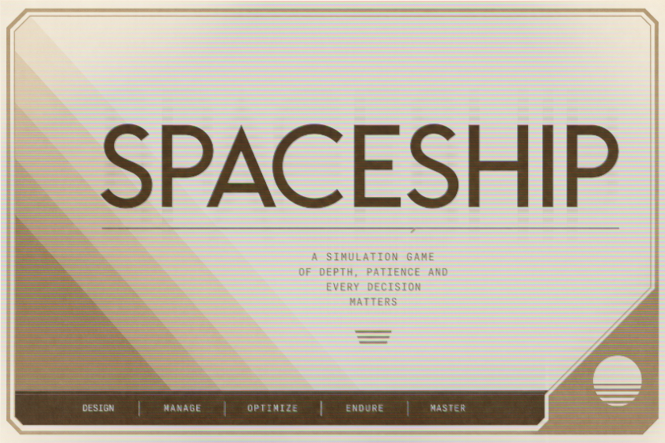

<p align="center">
  
</p>

<h1 align="center">Spaceship Command</h1>

<p align="center">
  A small ship. A wide chart. Time to think.
</p>

<p align="center">
  <a href="https://github.com/Aquaslopper/SPACESHIP/actions/workflows/native-cpp.yml">Windows builds</a>
  &nbsp; · &nbsp;
  <a href="#your-first-voyage">First voyage</a>
  &nbsp; · &nbsp;
  <a href="NATIVE-PORT.md">Port status</a>
  &nbsp; · &nbsp;
  <a href="CONTRIBUTING.md">Contributing</a>
</p>

---

**Spaceship Command** is an offline, action-driven ship-management game about
keeping a small vessel—and the people aboard it—going. Tend the filters, share a
meal, take a contract, and decide what lies beyond the next crossing.

It is a game to settle into, at the pace of a morning coffee. There is no clock
running behind your back: **the world advances when you commit a gameplay action**.
You can read, consider a route, or step away without losing a moment aboard.
Unhurried does not mean consequence-free. Air, power, supplies and crew need your
attention when the voyage moves on.

## Come aboard

The **native Windows edition** is a real C++ application, with its own interface
and simulation. No browser, HTA host, Node installation or online service is needed
to play.

1. Open [Windows builds](https://github.com/Aquaslopper/SPACESHIP/actions/workflows/native-cpp.yml)
   and choose a **successful run for `main`**.
2. Under **Artifacts**, download **`spaceship-windows-x64`**. GitHub may ask you to
   sign in to download it.
3. Extract the **whole ZIP** to a folder you can write to, then run `spaceship.exe`.
   Keep the accompanying folders beside it.

```text
Spaceship Command/
├── spaceship.exe
├── music/             Ambient shipboard music
├── sounds/            Action and readout cues
└── saves/             Three voyage slots and their backups
```

The archive also includes a Windows quick-start, migration notes and the dependency
license notice. Builds are currently distributed as CI artifacts, not a versioned
release; if an older artifact has expired, use a newer successful run.

> **A note on the voyage so far**
>
> The native edition is playable, but its conversion is **not yet feature-identical**
> to the original game. The original interface is being reconstructed, not redesigned;
> [visual parity is still unfinished](docs/VISUAL-PARITY.md). Some artwork, settings and edge-case behavior remain to be
> ported or verified. See [the migration notes](NATIVE-PORT.md) for the precise status.
> The original [`Spaceship.hta`](Spaceship.hta) remains preserved as the reference
> edition, with its own [interface and voyage guide](docs/REFERENCE-GUIDE.md).

## Life aboard

| A little responsibility | A little possibility |
| --- | --- |
| **Keep the ship breathing.** Seat canisters, maintain the filter bank, watch the drive and prepare rations. | **Follow the chart.** Seven regions, 48 systems and 243 destinations form the authored galaxy. |
| **Look after your crew.** Stage orders, arrange training, make room for rest and listen to the people doing the work. | **Make a living.** Trade between regional markets, recover salvage, package surveys and take station commissions. |
| **Make room for memory.** Relationships, care, discoveries and disagreements leave traces in the Simulacron. | **Look a little closer.** Turn selected memories into insight, investigate a signal, and choose what to carry forward. |

You begin aboard the compact **SC Wren**, with four crew, six berths and a
40 m³ hold. A larger ship can come later. For now, there is enough to get to know.

The Simulacron is an authored, offline simulation—not a language model or an
external AI service. Its memories and desires follow the crew's actual voyage.

## Your first voyage

There is no need to learn every compartment at once.

1. **Take a look around.** Select a page on the left, choose a target, then read its
   details. Click a compartment on the deck plan to open it. Browsing is free.
2. **Make breathing a priority.** Open the **O2 Filter Room** and seat available
   canisters. Installation takes work; other useful gameplay actions advance it.
   When all three are seated, start the filter bank if it is not already running.
3. **Give the crew a plan.** In **Crew quarters**, stage each person's orders, then
   issue the sheet as one action. Staging is free; crew carry out the work while
   the rest of the ship continues.
4. **Choose a nearby crossing.** In **Navigation**, select **Tolme Anchorage** and
   start travel. Tend other jobs while the crossing progresses. When the readout
   is ready, **acknowledge arrival**—that acknowledgement is free.
5. **Find a rhythm.** Trade or take a commission at a station, replenish supplies,
   and check the incident reports before committing to the next leg.

The [Windows quick-start](WINDOWS-README.txt) covers controls, folders and importing
an existing voyage. Unavailable commands explain their requirements in the detail
pane; scroll the command panel if not everything fits on screen.

### One action is one turn of the ship

A successful gameplay command advances the whole simulation once: ongoing work,
survival, crew needs and existing control cooldowns. Reading, selecting, staging
orders, changing audio settings and acknowledging completed readouts do not.

| Control category | Cooldown |
| --- | --- |
| Routine | 5 other committed actions |
| Ship systems | 10 other committed actions |
| Space operations, including **Stand watch** | 15 other committed actions |
| Critical decisions | 20 other committed actions |

These are **action counts, not seconds**. A control starts its cooldown after its
own action; other successful gameplay clicks count it down. A blocked repeat
advances nothing. Alternate useful commands rather than repeatedly pressing one.

The left sidebar separates **ongoing work** from **named control cooldowns**.
Buttons also show how many action clicks remain before they become available.

## A place for everything

**Saves.** Three slots live in `saves/` beside the EXE, with a `.bak` copy of the
previous save. If that folder is read-only, the game uses
`%LOCALAPPDATA%\SpaceshipCommand\saves` instead. **Home / Handbook → Open saves
folder** shows the active location. Earlier native slots in the old per-user
folder remain discoverable when a new slot is absent.

**Older voyages.** **Import HTA save** can translate supported UTF-8 and Windows
UTF-16 saves without changing the original file. Import is not universal: unknown
work or unmapped active cooldowns are refused explicitly. Keep your originals and
read the [compatibility notes](NATIVE-PORT.md#saves-and-hta-import) before migrating.

**Sound.** Music, effects and volume have free controls on Home and Handbook.
Playback begins after interaction. The bundled ambient loop and cues come from the
reference game's synthesizer; no streaming or downloads are involved. You can
replace the WAV files using the formats described in
[`music/README.txt`](runtime/music/README.txt) and
[`sounds/README.txt`](runtime/sounds/README.txt). Missing or unsupported audio stays
silent rather than stopping the voyage.

## Around the repository

- **[Native port status](NATIVE-PORT.md)** — implemented systems, known differences
  and verification boundaries.
- **[Reference edition guide](docs/REFERENCE-GUIDE.md)** — the original HTA's fuller
  handbook, including its own controls and settings. Story details are included.
- **[Development guide](docs/DEVELOPMENT.md)** — build the C++ edition, run checks,
  and find the shared simulation.
- **[Contributing](CONTRIBUTING.md)** — report a rough edge or help with the port.
- **[Spaceship manifesto](Spaceship%20manifesto.pdf)** and
  **[concept notes](spaceship%20concept.pdf)** — the wider ideas behind the ship.

The original artwork and design documents stay alongside the project. The native
port is growing toward that vision, without pretending every part is finished.

---

*Put the kettle on. The ship can wait.*
